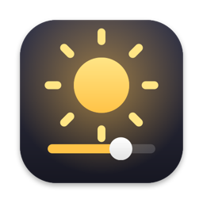

# BrightBar



A macOS menu bar app that puts a brightness slider on every external monitor, the way the
built-in display already has one.

- **Per-monitor brightness and contrast** – one row per connected display, named the way
  System Settings names it, ordered left to right as the displays are arranged.
- **Built-in display** – the laptop panel gets a row too, at the bottom, driven by the same
  control the keyboard brightness keys use.
- **All displays** – a master slider that moves every display, external and built-in, together.
- **Real hardware control** – it changes the monitor's own backlight over DDC/CI, not a software
  dimming overlay, so the setting survives sleep, reboots and unplugging.

Works on Apple Silicon Macs running macOS 14 or newer.

## Opening it

Click the sun icon in the menu bar, or press **⌃⌥B** (Control + Option + B) from anywhere.
If the menu bar is full and the icon is hidden under the notch, the hotkey (or relaunching the app)
shows the sliders as a floating panel at the top-right of the screen instead.

Values are re-read from the monitors each time the panel opens, so changes made with the
monitor's own buttons show up too. The ↻ button re-scans on demand.

Diagnostics are written to `~/Library/Logs/BrightBar.log`.

## Build and run

```bash
./build.sh            # release build → build/BrightBar.app
open "build/BrightBar.app"
```

`./build.sh debug` builds a debug binary instead. The app is ad-hoc signed, so it runs locally
without a developer account. The icon is rendered by `App/Icon/make_icon.swift` on the first build.

## How it works

macOS has no public API for external display brightness. Monitors do, though: **DDC/CI** is a
small I2C protocol that rides along the HDMI or DisplayPort cable, and brightness (VCP code `0x10`)
and contrast (`0x12`) are standard controls in it.

On Apple Silicon each display connector shows up in the IORegistry as a `DCPAVServiceProxy`
with `Location = External`. BrightBar opens it with the private `IOAVServiceCreateWithService`
call and talks DDC/CI through `IOAVServiceReadI2C` / `IOAVServiceWriteI2C` – the same calls used
by MonitorControl, BetterDisplay and m1ddc. Being private API, this is fine for a locally signed
app but would not pass App Store review.

To know which connector is which monitor, the app reads the monitor's EDID over the same I2C bus
and matches its vendor, model and serial number against what CoreGraphics reports for each
screen. That is how a row gets the name "DELL P2422H (2)" rather than "connector 3".

The built-in panel is not a DDC device; its row goes through `DisplayServicesSetBrightness` in
the private DisplayServices framework, the same path as the brightness keys. While the panel is
open the row is re-read once a second so pressing those keys moves the slider too.

Slider drags are applied optimistically in the UI and coalesced to one I2C write per ~80 ms,
with a final write when the slider is released. I2C is a little flaky, so every read is retried
a few times with increasing delays. Each slider owns its position while it is being dragged and
only then pushes values out; a slider bound straight to a derived value such as the
"All displays" average would otherwise fire its setter whenever another slider moved.

## If a monitor is missing

- **DDC/CI must be enabled in the monitor's on-screen menu.** Many monitors ship with it on,
  some (notably LG and Samsung) hide it under *Others* or *General*.
- **Docks and hubs can block DDC.** Monitors plugged straight into the Mac, or through a
  Thunderbolt dock that passes DisplayPort through, generally work; DisplayLink adapters do not.
- **Apple and some Studio-type displays** are not DDC devices; macOS controls those natively.
